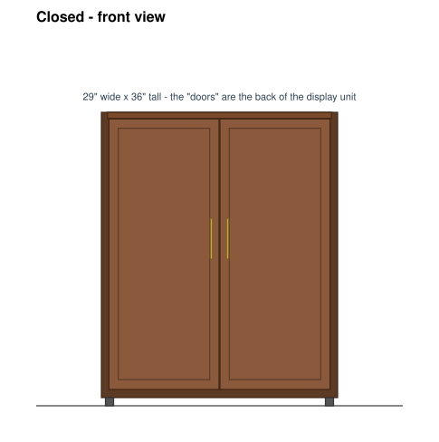

# Flip-Up Buffet Arcade Cabinet (Swap Arcade style)

A free-standing cabinet modeled on the [Swap Arcade](https://www.kickstarter.com/projects/amat/swap-arcade-full-arcade-that-turns-into-a-furniture-cabinet).
When closed it looks like a mid-century double-door cabinet. The "doors"
don't open, because they're the back of the display unit. To play, the
display unit swings up out of the front, and a front panel on it folds down
into the control deck.

| Mode | Swap Arcade (published) | This design |
|---|---|---|
| Closed | 36 × 29 × 13.5 in (91.4 × 73.7 × 34.3 cm) | **36 H × 29 W × 13.5 D in** |
| Arcade | 70 × 28 × 14 in (177.8 × 71.1 × 35.6 cm) | **64.5 H** (70 with the lift-off topper) × 29 W × 13.5 D, plus the deck reaching 7.9 in forward |
| Screen | 27 in | 27 in max |
| Weight | ~100 lb / 45 kg | ~90–100 lb |

| Closed (front) | Closed (side) | Open (side) | Flipping |
|---|---|---|---|
|  |  |  |  |

The side views are sections with the front on the left and the wall on the
right. The dashed outline is the side panel.

---

## How it works

**What matches the Swap Arcade.** Their published details describe these
features, and this design has all of them:
- The closed front is fake double doors made from the back of the display unit.
- The display unit pivots up out of the front.
- A front panel folds down to become a 2-player control deck.
- Storage is in the base and can only be reached in arcade mode.
- Locking pins hold the display unit in both positions.

**What's my own engineering.** Their exact hinge geometry and counterbalance
aren't public, so these parts are my design:
- the pivot position and clearances;
- the deck pocket;
- the storage layout;
- the outrigger feet.

### The display unit
It's a 34 × 27.25 × 6.75 in box holding the monitor, the marquee with a
speaker on each side, and the control deck. Optionally, the mini PC can go in
there too.

- **Closed:** it hangs **upside down** in a 6.75 in slot at the front of the
  cabinet. The screen faces inward. Its 1/2 in walnut-veneered back is the
  cabinet front, with a center groove and two dummy pulls so it reads as
  double doors.
- **Flipping:** a 1/2 in pivot bolt goes through both side panels, 2.75 in
  below the top of the unit. You pull the bottom of the unit out toward you
  and walk it up and over. It turns 180° and sits upright in the same slot.
- **Locking:** two spring index plungers per side lock it closed and open.
  These are the "locking pins."

### The control deck
- **Folded:** the deck is a shallow box (8 × 25.25 × 3.5 in) stowed upright
  in a pocket in the lower front of the display unit. Its plain back is flush
  with the unit's front, and the sticks point into the unit.
- **Down:** in arcade mode, you pull the finger lip and the deck drops 90° on
  a hinge along its bottom edge. It ends up horizontal with the **controls on
  top at 38.5 in**. Two drop-front stays hold it level.
- **The empty pocket** behind the deck becomes a recessed panel above the
  controls. Use it for a decal or LED strip.

### Storage
- There's a 4.6 in deep, 27.5 in wide bay with 2 shelves behind the slot.
- The inset doors are hidden behind the display unit when closed. In arcade
  mode, the unit is up and the doors open under the deck.
- It holds controllers, cables, games and a slim PC. A 4.6 in depth is tight
  for a full slim PC, so mount the mini PC inside the display unit behind the
  monitor if it doesn't fit.

### Height
The display unit has to fit inside the 36 in box when closed, and 2.75 in of
it stays inside the side panels when it's up for rigidity. That makes it
64.5 in tall. The Swap Arcade's 70 in likely includes a marquee section, so
add the 5.5 in lift-off topper to match.

---

## Things to know before you build

- **You need about 28 in clear in front** while flipping, and nothing behind
  it. It can live against the wall.
- **Pull the outrigger feet out before flipping** (12 in forward), and leave
  them out while playing. When the unit is horizontal, its weight is well in
  front of the cabinet.
- **Lifting:** it takes about **18 lb at the end of the unit** when it's
  horizontal. The unit weighs about 35 lb.
  - The Swap Arcade uses a counterbalance. I haven't designed one here,
    because a gas strut that assists over a full 180° swing needs testing on
    a mock-up.
  - Start with two people. Once the mock-up is working, I can work out a
    strut or torsion-spring layout.
- **Max screen: 27 in 16:9** (26.25 in inside width).
- **Strap it to the wall** like any tall furniture.

---

## Your screen (fill in later)

Measure the monitor **without its stand**, then run:

```bash
python3 design.py --monitor-w <width incl. bezel> --monitor-h <height incl. bezel> --monitor-d <thickness>
```

It prints the dimensions and cut list. It also checks that the unit, the
folded deck and the sticks clear every fixed part at every degree of the flip,
with at least 1/4 in to spare. Then it redraws all four SVGs. The defaults
assume a typical 27 in monitor (24.1 × 14.3 × 2.2 in).

- [ ] Width × height × thickness (no stand): ____ × ____ × ____
- [ ] VESA pattern (75 / 100): ____
- [ ] Weight: ____

---

## Key dimensions (inches)

Coordinates: **y** = distance back from the front face, **z** = height from
the floor.

| Item | Value |
|---|---|
| Leveling glides | 1 in (carcass sits at z = 1) |
| Side panels | 13.5 D × 35 H, 3/4 ply, 27.5 in apart |
| Display slot | y 0 → 7.375, open at the front, top and bottom |
| **Pivot** | **y = 3.5, z = 33.25**, 1/2 in bolt through both side panels |
| Lock plungers | y = 3.5 at z = 31.75 and z = 34.75 (both sides) |
| Display unit closed / open | z 2 → 36 / z 30.5 → 64.5 |
| Deck hinge (open) | on the unit front at z = 35; deck top at 38.5 |
| Monitor | from z = 43.5 |
| Marquee and speakers | z 58.75 → 63.75 |
| Storage | doors at y = 7.375, z 1.75 → 29.75; fixed face rail above them; 2 shelves |

The tightest spots during the flip:

- the unit's rounded end passes the face rail with about 0.4 in to spare;
- the folded sticks sit 1/4 in short of the unit's back panel.

**If you change any dimension, change it in `design.py` and re-run it.**

---

## Cut list

Generated by `design.py` for the default 27 in monitor.

### 3/4" plywood (one 4×8 sheet)
| Part | Qty | Size | Notes |
|---|---|---|---|
| Side panel | 2 | 35 × 13-1/2 | Drill as a clamped pair for the pivot and plunger holes |
| Back | 1 | 27-1/2 × 34-1/4 | Structural; glue along its full height |
| Top | 1 | 27-1/2 × 6-1/8 | Fixed top behind the slot |
| Bottom | 1 | 27-1/2 × 4-5/8 | Storage floor; there's no floor under the slot |
| Shelf | 2 | 27-1/2 × 4-5/8 | Set in dadoes |
| Face rail | 1 | 27-1/2 × 5-1/2 | Fixed, above the storage doors |
| Storage door | 2 | 27-7/8 × 13-21/32 | Inset; cut last, to fit the opening |

### 1/2" Baltic birch (one 5×5 sheet)
| Part | Qty | Size | Notes |
|---|---|---|---|
| Unit side | 2 | 34 × 6-3/4 | 2-1/4" radius on the two corners at the pivot end, 1/2" at the other end |
| Unit end cap | 2 | 26-1/4 × 6-1/4 | |
| Deck pocket back | 1 | 26-1/4 × 8 | Two 2-1/2" holes where the sticks pass through when folded |
| Deck control plate | 1 | 25-1/4 × 8 | Buttons and sticks mount here |
| Deck side | 2 | 8 × 2-3/4 | |
| Deck end | 2 | 24-1/4 × 2-3/4 | Hinge end and front lip (finger pull) |

### Show faces and 1/4" sheet
| Part | Qty | Size | Notes |
|---|---|---|---|
| Unit back ("double doors") | 1 | 34 × 27-1/4 | 1/2" walnut-veneer ply. Rout a center groove and add 2 dummy pulls |
| Bezel | 1 | 21-1/2 × 27-1/4 | 1/4" black MDF; screen and marquee/speaker cutouts |
| Deck cover | 1 | 25-1/4 × 8 | 1/4" ply. Screwed on; it's the unit's lower front face when folded, so veneer it to match |

### Hardwood and acrylic
| Part | Qty | Size | Notes |
|---|---|---|---|
| Deck pocket floor / hinge rail | 1 | 26-1/4 × 3-1/2 × 3/4 | |
| Unit pivot doubler | 2 | 7 × 6-1/4 × 3/4 | Glued inside each unit side at the pivot end |
| Outrigger bar | 2 | 16 × 1-1/2 × 3/4 | Anti-tip feet |
| Marquee | 1 | 18-1/4 × 5 × 1/8 acrylic | 3" speaker grille on each side |

**Before you cut:** measure your plywood ("3/4" is often 23/32"). Cut the
display unit and the storage doors last, sized from the real gap between the
assembled side panels.

---

## Hardware and parts list

**Pivot and locks**
- 2× 1/2 in-13 × 3 in hex bolts + nylon-insert lock nuts + fender washers
- 4× 1/2 in ID flanged bronze bushings
- 4× 1/2 in UHMW or nylon washers
- 4× 1/2 in spring index plungers with pull ring and rest position
- 4× 1/2 in ID steel sleeves for the plunger holes
- 2× 3/16 in steel plates, about 2 × 6 in, on the outside of each side panel at the pivot

**Control deck**
- 1× 25 in piano hinge (heavy gauge), along the bottom edge of the deck
- 2× drop-front / flap stays rated 20 kg (45 lb) or more, one each side (they sit in the 1/2 in gaps beside the deck)
- 2× magnetic or touch latches (hold the deck folded)

**Carcass**
- 4× 1 in leveling glides + T-nuts (or short mid-century tapered legs; every height goes up by the leg height)
- 4× inset Euro hinges + 2 knobs (storage doors)
- 2× brass dummy pulls (the fake doors)
- UHMW tape, stop pins and felt pads (outriggers)
- Anti-tip wall strap
- Wood glue, pocket screws, brads, walnut edge banding

**Electronics** (the Swap Arcade ships a Raspberry Pi 4 running Batocera, and lists an N100 mini PC as an upgrade)
- 27 in max monitor with VESA mount and a flat VESA plate
- 2-player kit: 2 Sanwa JLF-style sticks + 16 × 30 mm buttons + USB encoder. The deck is 2-3/4 in deep inside.
- 2× 3 in speakers + small 2×15 W amp
- 12 V LED strip (marquee)
- Pi 4/5 or a mini PC, mounted inside the display unit behind the monitor. That way everything flips together and only one power cord crosses the pivot.

---

## Cable routing

Put the computer, amp and power supplies **inside the display unit**. Then the
only thing that has to cross the flip is **one power cord**:

1. Run it out of the unit side wall 1 in from the pivot.
2. Leave a 12 in slack loop in the slot.
3. Pass it through a grommet in the face rail to a power strip in storage.

If the PC lives in storage instead, run HDMI and USB the same way. Use slim,
flexible cables and cycle the flip 10–20 times before closing everything up.

---

## Build order

1. **Mock it up.** Use cardboard or scrap MDF for the side panels and the
   display unit, then check the swing.
2. **Side panels.** Drill them as a pair. Fit the steel plates and bushings.
3. **Carcass.** Glue up the back, bottom, shelves, top and face rail. Square
   it up.
4. **Outriggers.** Fit the channels, UHMW tape and stop pins.
5. **Display unit.** Build the box: sides, end caps, doublers, deck pocket and
   bezel. Round the corners. Drill the pivot and plunger holes.
6. **Control deck.** Build the box, cut the plate, and hinge it into the
   pocket. Fit the stays so it sits level at 38.5 in.
7. **Hang the unit.** Fit the nylon washers and pivot bolts, flip it slowly,
   and check the gaps. Then fit the plungers.
8. **Storage doors.**
9. **Electronics.** Fit the monitor, speakers, marquee and the PC behind the
   monitor. Route the power cord.
10. **Finish.** Veneer and finish the unit back, the deck cover, the side
    panels and the top in walnut. Rout the center groove and fit the pulls.

### Mode change checklist

**Cabinet → Arcade:**
1. Clear the top.
2. Pull out both outriggers.
3. Pull both plunger rings and set them in the rest position.
4. Swing the unit forward and up. Release the plungers so they click in.
5. Pull the finger lip so the deck drops onto its stays.
6. Set the topper on (optional) and power on.

**Arcade → Cabinet:** power off. Lift the deck to fold it, then reverse the
remaining steps.

---

## Open questions

- **"I have a slim…"** got cut off. Tell me what it is (a slim PC? a slim
  Arcade1Up?) and I'll fit it in.
- **Counterbalance:** say if you want one designed after the mock-up.
- **Legs:** do you want mid-century tapered legs like the Swap Arcade's
  furniture look? Legs raise both modes by their height. Alternatively, the
  unit can be shortened to keep 36 in closed.

Sources on the Swap Arcade: [Kickstarter](https://www.kickstarter.com/projects/amat/swap-arcade-full-arcade-that-turns-into-a-furniture-cabinet),
[Hackster.io](https://www.hackster.io/news/les-cookson-s-swap-arcade-hides-a-full-size-arcade-cabinet-in-a-compact-piece-of-furniture-5df2f6a26c18),
[Yanko Design](https://www.yankodesign.com/2026/06/12/this-retro-arcade-machine-folds-into-a-furniture-cabinet-right-out-of-pottery-barn/),
[New Atlas](https://newatlas.com/games/swap-arcade-gaming-system-folds-into-cabinet/).
