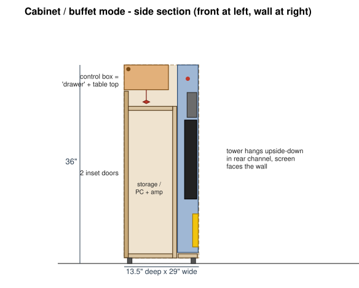
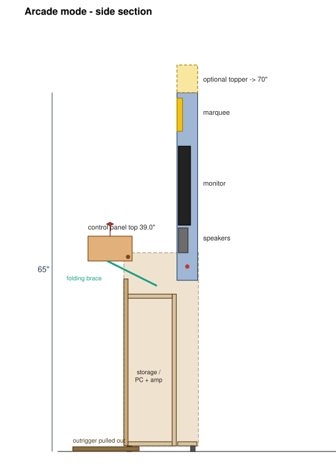
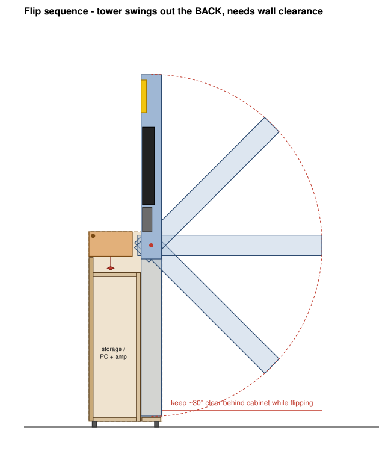

# Flip-Up Buffet Arcade Cabinet

A free-standing cabinet that looks like a small buffet/sideboard when closed and
flips up into a full-height arcade cabinet.

| Mode | Target (given) | This design |
|---|---|---|
| Cabinet / buffet (closed) | 36 × 29 × 13.5 in (91.4 × 73.7 × 34.3 cm) | **36 H × 29 W × 13.5 D in** |
| Arcade (open) | 70 × 28 × 14 in (177.8 × 71.1 × 35.6 cm) | **65 H** (70 with the lift-off topper) × 29 W × 13.5 D + 6.5 in control panel overhang |
| Weight | ~100 lb / 45 kg | ~90–100 lb with PC and ballast |

| Closed | Open | Flipping |
|---|---|---|
|  |  |  |

All drawings are side sections: front on the left, wall on the right. The
dashed outline is the side panel.

---

## How it folds

The cabinet has three moving parts. Each one pivots on bolts through the two
side panels.

1. **Tower (screen + speakers + marquee).** This is a 34 in tall, 3.75 in deep
   box. In buffet mode it hangs **upside down** in a 4 in channel at the back
   of the cabinet, with the screen facing the wall. A 1/2 in pivot bolt sits
   2.5 in from its top end. You lift the bottom of the tower up and out the
   back, swing it 180°, and it stands upright in the same channel with the
   screen facing forward. Spring index plungers lock it in both positions.
2. **Control box.** This is an 8 × 26.5 × 4.5 in box. In buffet mode it sits
   in the top front of the cabinet, controls facing down into the cabinet. Its
   plain lid is the buffet tabletop and its front looks like a drawer. It
   pivots near its front-top corner, flips forward 180°, and lands in front of
   the cabinet with the controls facing up, **39 in off the floor**. Two
   locking folding braces hold it there.
3. **Outrigger feet.** Two hardwood bars under the cabinet slide 9 in forward
   in arcade mode, so the cabinet can't tip when someone leans on the
   controls.

The bottom 28 in is ordinary storage behind two inset doors: the PC or
console, amp, power strip and controllers.

### Why 65 in and not 70 in

The tower has to fit inside a 36 in box when closed, so it can only be about
34 in long. Some of it also has to stay inside the side panels when it's up,
because that overlap is what keeps it rigid. This design keeps 2.5 in inside
the side panels, which gives 65 in. A 5 in lift-off marquee topper (it stores
in the cabinet) brings it to 70 in. With the topper, the screen and marquee
sit at about the height of a commercial Arcade1Up on a riser.

### Things to know before you build

- **The tower swings out the back.** You need about **30 in clear behind the
  cabinet** while flipping (see `flip_sequence.svg`). Slide it out from the
  wall, flip it, and push it back. Once it's up, the tower stays inside the
  13.5 in footprint.
- Lifting the tower takes roughly **10–12 lb at the end** when it's
  horizontal. The tower weighs about 25 lb with a 27 in monitor.
- **Max screen: 27 in 16:9.** The tower interior is 26.25 in wide and 3.25 in
  deep (including the VESA bracket). A 32 in monitor won't fit without making
  the whole cabinet wider.
- In arcade mode there's an open "well" about 7 in deep between the control
  panel and the screen, over the fixed deck. It works as a controller and
  phone cubby. A 1/4 in drop-in cover is optional.
- **Strap it to the wall** in buffet mode, like any tall furniture. Put 15–20
  lb of ballast (a paver or bags of steel shot) low and to the front of the
  storage section.

---

## Your screen (fill in later)

Measure the monitor **without its stand**, then run:

```bash
python3 design.py --monitor-w <width incl. bezel> --monitor-h <height incl. bezel> --monitor-d <thickness>
```

The script prints PASS/FAIL clearance checks and the cut list, and redraws the
three SVGs. The defaults assume a typical 27 in monitor (24.1 × 14.3 × 2.2
in). Also write down:

- [ ] Width × height × thickness (no stand): ____ × ____ × ____
- [ ] VESA pattern (75 / 100): ____
- [ ] Weight: ____
- [ ] Which side the ports exit (back-down is best): ____
- [ ] Power brick: internal / external

Common 16:9 sizes, including a thin bezel:

| Diagonal | W × H (approx.) | Fits? |
|---|---|---|
| 22 in | 19.6 × 11.6 | yes |
| 24 in | 21.3 × 12.6 | yes |
| 27 in | 24.1 × 14.3 | yes (max) |
| 32 in | 28.5 × 16.8 | no |

---

## Key dimensions (inches)

Coordinates: **y** = distance back from the front face, **z** = height from
the floor.

| Item | Value |
|---|---|
| Leveling glides | 1 in (carcass sits at z = 1) |
| Side panels | 13.5 D × 35 H, 3/4 ply, 27.5 in apart |
| Inset doors | z 1.06 → 31.25 (1/4 in reveal under the control box) |
| Partition (back of storage) | front face at y = 8.75, top at z = 28.5 |
| Fixed deck | top at z = 28.5 |
| Tower channel | y 9.5 → 13.5 (4 in), open at the top and back |
| **Tower pivot** | **y = 11.5, z = 33.5**, 1/2 in bolt |
| Tower lock plungers | y = 11.5 at z = 32.0 and z = 35.0 (both sides) |
| Tower in arcade mode | z 31 → 65 |
| **Control box pivot** | **y = 0.75, z = 35.25**, 3/8 in shoulder bolt |
| Control box stored | y 0 → 8, z 31.5 → 36 |
| Control box in arcade mode | y −6.5 → 1.5, top surface at z = 39 |
| Folding brace anchors | side panel inside face at (y 6, z 30) → box side at (y −3, z 34.5) when open |
| Arcade layout on tower | speakers z 36–40.5, monitor from z 41, marquee z 58–64 |

The clearances are tight on purpose. The tower's rounded end misses the stored
control box by about 3/4 in, and the control box misses the stored tower by
about 3/4 in. **If you change any dimension, change it in `design.py` and
re-run the checks.**

---

## Cut list

Generated by `design.py`. Thickness is listed per part.

| Part | Qty | Material | Length | Width | Notes |
|---|---|---|---|---|---|
| Side panel | 2 | 3/4" ply | 35" | 13.5" | pivot + lock holes, see table above |
| Bottom | 1 | 3/4" ply | 27.5" | 8" | front compartment floor |
| Partition | 1 | 3/4" ply | 27.5" | 26.75" | structural back of storage, 2" cable grommet |
| Deck | 1 | 3/4" ply | 27.5" | 8" | top at z = 28.5, vent holes |
| Rear stretcher | 1 | 3/4" ply | 27.5" | 3.5" | lies flat under the tower channel |
| Door | 2 | 3/4" ply | 30.188" | 13.656" | inset, 1/16" gaps |
| Control box lid (buffet top) | 1 | 3/4" ply | 26.5" | 8" | show face; becomes the panel underside |
| Control plate | 1 | 1/2" ply | 25.5" | 7" | + optional 1/8" acrylic overlay |
| Control box front/back | 2 | 1/2" ply | 26.5" | 3.75" | front is the "drawer face" |
| Control box ends | 2 | 1/2" ply | 7" | 3.75" | 3/8" pivot bushing in each |
| Tower side | 2 | 1/2" ply | 34" | 3.75" | 1" radius on the short-end corners |
| Tower end cap | 2 | 1/2" ply | 26.25" | 3.25" | |
| Tower pivot doubler | 2 | 3/4" hardwood | 6" | 3.25" | inside each tower side at the short end |
| Tower back | 1 | 1/4" ply | 34" | 27.25" | vent slots behind the monitor |
| Tower bezel | 1 | 1/4" black MDF/ply | 34" | 27.25" | cutouts for speakers, screen, marquee |
| Marquee acrylic | 1 | 1/8" acrylic | 26.25" | 6" | print or vinyl behind |
| Outrigger bar | 2 | 3/4" hardwood | 12" | 1.5" | slides 9" forward in arcade mode |
| Topper (optional) | 1 | 1/2" ply box | 27.25" | 5" × 3.75" | lift-off, sits on 2 dowels |

**Sheet goods:** one 4×8 sheet of 3/4 in birch ply, one 5×5 sheet of 1/2 in
Baltic birch, one 4×8 sheet of 1/4 in (ply for the back, black MDF for the
bezel; a half sheet of each also works).

---

## Hardware and parts list

**Pivots and locks**
- 2× 1/2 in-13 × 3 in hex bolts (tower pivot) + nylon-insert lock nuts + 4 large fender washers
- 4× 1/2 in ID flanged bronze bushings (2 in the side panels, 2 in the tower doublers)
- 4× 1/2 in UHMW/nylon washers (between the tower and the side panels)
- 4× 3/8 in spring index plungers with pull ring and rest position (2 per side, tower lock)
- 4× 3/8 in ID steel sleeves or bushings for the plunger holes in the tower doublers
- 2× 3/16 in steel plates, about 2 × 6 in, on the outside of each side panel around the tower pivot and plungers (spreads the load in the plywood)
- 2× 3/8 in shoulder bolts + bushings (control box pivot)
- 2× 10 in locking folding braces (folding table-leg brace style), rated 50 lb or more, for the control box
- 2× magnetic catches (holds the control box closed in buffet mode)

**Carcass**
- 4× 1 in adjustable leveling glides + T-nuts
- 4× inset Euro hinges (or butt hinges) + 2 knobs + 2 magnetic catches for the doors
- UHMW tape for the outrigger channels, 2 felt pads for the outrigger ends
- Furniture anti-tip wall strap
- Wood glue, 1-1/4 in pocket screws, 1 in brad nails, edge banding

**Electronics**
- Monitor, 27 in max, VESA mount, with a low-profile flat VESA plate
- 2-player control kit: 2 sticks + 16–20 × 30 mm buttons + USB encoder(s). Sanwa JLF-style sticks fit the 3.25 in box depth; check below-panel depth on anything else.
- 2× 3 in full-range speakers + small 2×15 W amp
- 12 V LED strip + 12 V supply for the marquee
- Computer: your slim PC, mini PC, Pi 5 or console in the storage section
- Switched power strip, slim HDMI cable (flexible, at least 6 ft), spiral cable wrap, 2 in desk grommet

---

## Cable routing through the flip

The tower rotates 180°, so cables have to leave it **near the pivot axis**.
That way they only twist instead of stretching.

1. Drill a 1.5 in hole in the tower back, 2 in from the pivot, on the
   short-end side.
2. Run HDMI, monitor power, speaker wire and the marquee 12 V out of that hole
   in spiral wrap.
3. Leave an **18 in slack loop** hanging in the tower channel, then pass it
   through a 2 in grommet in the partition at about z = 24 into the storage
   section.
4. Cycle the tower 10–20 times before closing everything up. Watch that the
   loop never catches on the stretcher or the side-panel edges.

The control box wiring (USB from the encoders) takes the same approach: put
the exit on the box's back wall near the pivot, then run a slack loop down
into the storage section.

---

## Build order

1. **Mock it up first.** Cut the two side panels and a cardboard or scrap MDF
   tower and control box. Bolt them on, then check the swing clearances and
   the feel of the flip *before* cutting good plywood. Everything is tight to
   about 3/4 in.
2. **Side panels.** Lay out the pivot and plunger holes from the table above.
   Drill both panels together (clamp them as a pair) so the holes line up.
   Install the steel plates and bronze bushings.
3. **Carcass.** Glue and screw the bottom, partition, deck and rear stretcher
   between the sides. Square it up. The partition is what keeps the cabinet
   from racking, so glue it along its full height.
4. **Outriggers.** Rout two 1.5 × 3/4 in channels in the underside of the
   bottom (or screw on runners), line them with UHMW tape, fit the bars, and
   add stop pins so they pull out 9 in and no further.
5. **Tower shell.** Glue the sides, end caps and doublers. Round the four
   short-end corners to a 1 in radius. Drill the pivot hole and the two
   plunger holes 1.5 in either side of it, then press in the bushings and
   sleeves.
6. **Hang the tower.** Fit it with the nylon washers and pivot bolts. Flip it
   up and down and adjust until it swings freely with no rubbing. Then install
   the index plungers.
7. **Control box.** Build the box, cut the control plate for your layout, and
   mount it on its pivots. Flip it and set the folding braces so the panel
   sits level at 39 in.
8. **Doors.** Hang them with a 1/4 in reveal under the control box.
9. **Electronics.** Mount the monitor, speakers and marquee LEDs in the tower.
   Put the PC, amp and power strip in the storage section, then route and test
   the cable loop.
10. **Finish.** Sand, then paint or veneer. Add vinyl art on the tower bezel
    and marquee, and treat the buffet tabletop (control box lid) as a show
    surface.

### Mode change checklist

**Buffet → Arcade:** open the doors and slide the outriggers out → pull the
cabinet out from the wall → pull both tower plungers → swing the tower up and
let the plungers click in → push the cabinet back → flip the control box
forward and lock the braces → set the topper on (optional) → power on.

**Arcade → Buffet:** run those steps in reverse. Power off before flipping the
tower.

---

## Open questions / assumptions

- **"I have a slim…"** got cut off. I assumed it means a slim PC or console
  that goes in the storage section. If it's a slim Arcade1Up you want to
  re-house, the control panel and monitor dimensions may change. Tell me which
  one and I'll adjust.
- The control panel height is 39 in, which is good for standing play or a bar
  stool. For seated play, lower it by shrinking `BOX_H` and re-running the
  checks.
- The monitor is mounted vertical (no tilt), like most slim/fold-flat cabs.
